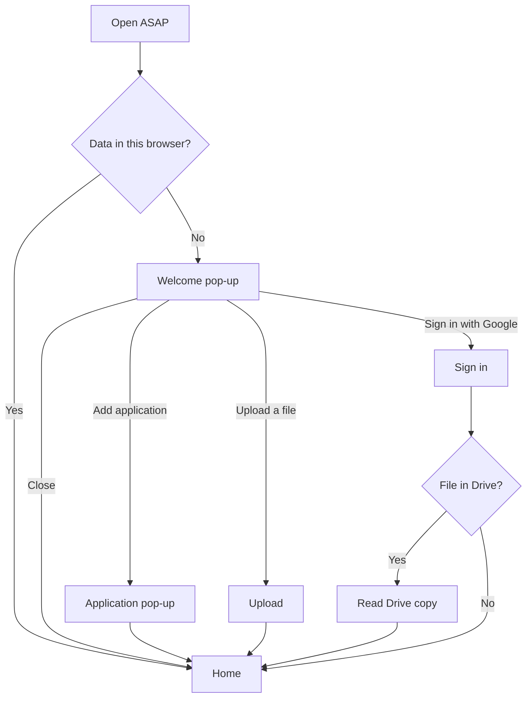
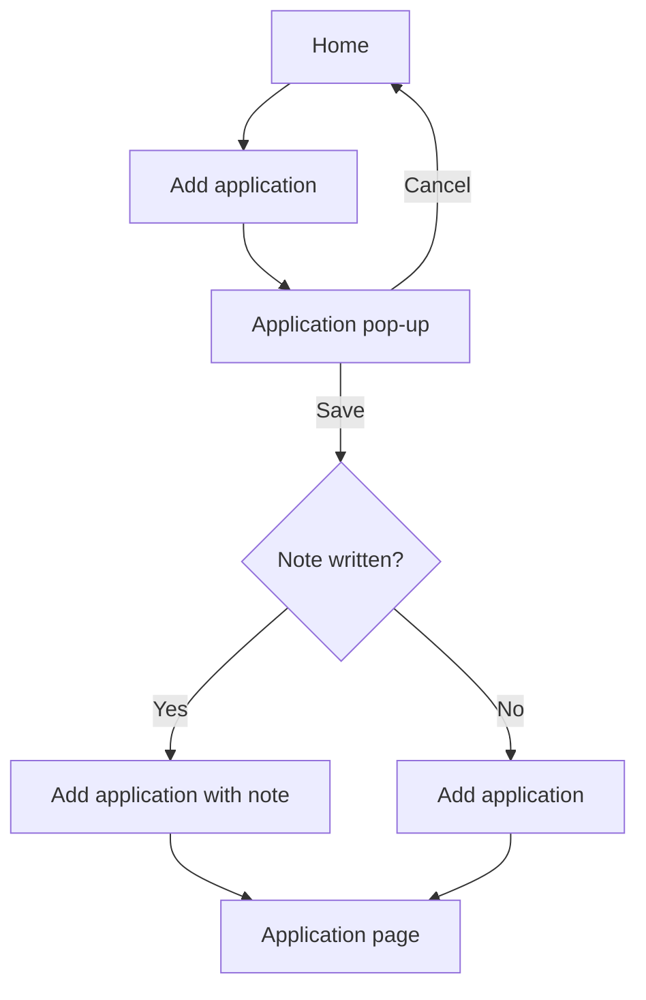
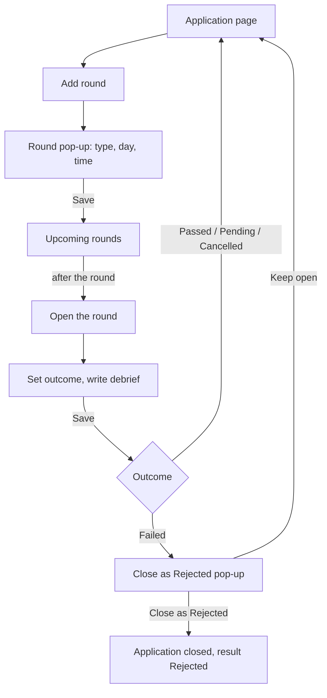
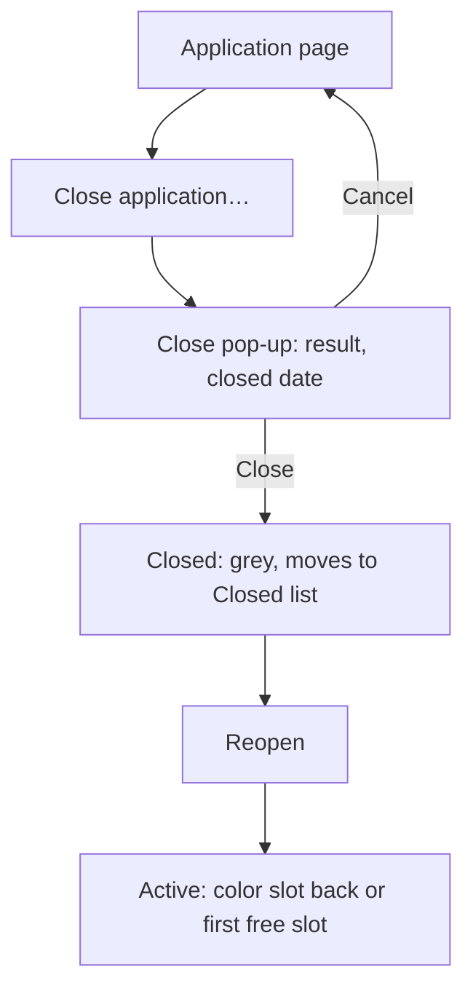
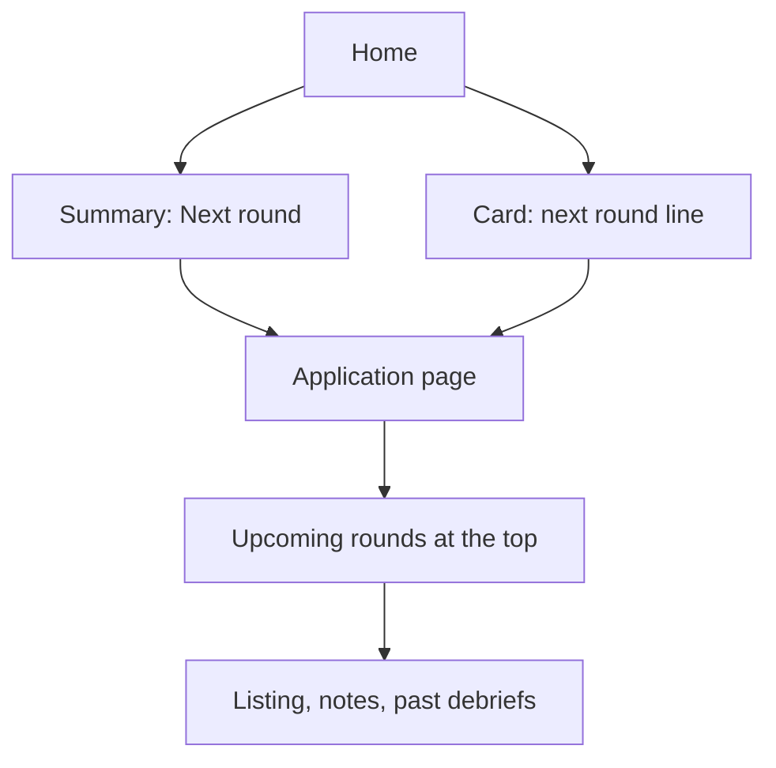
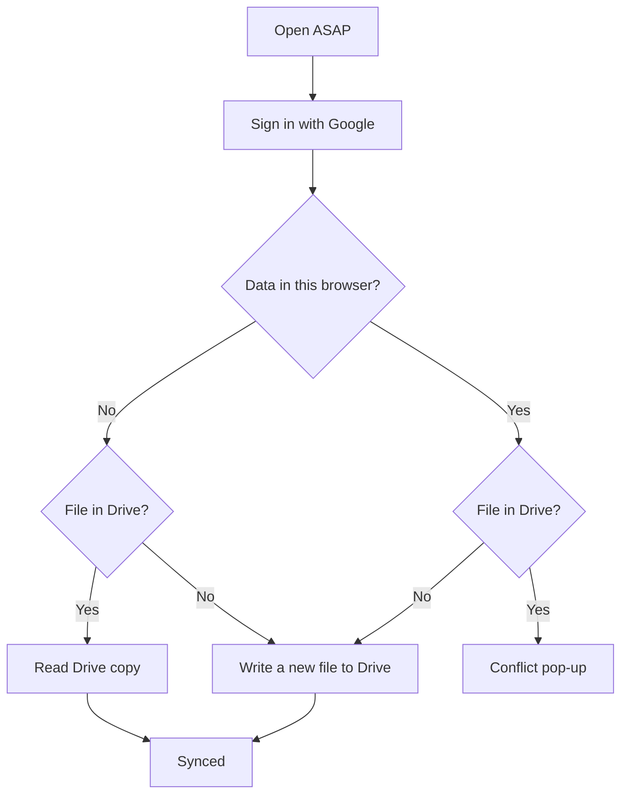
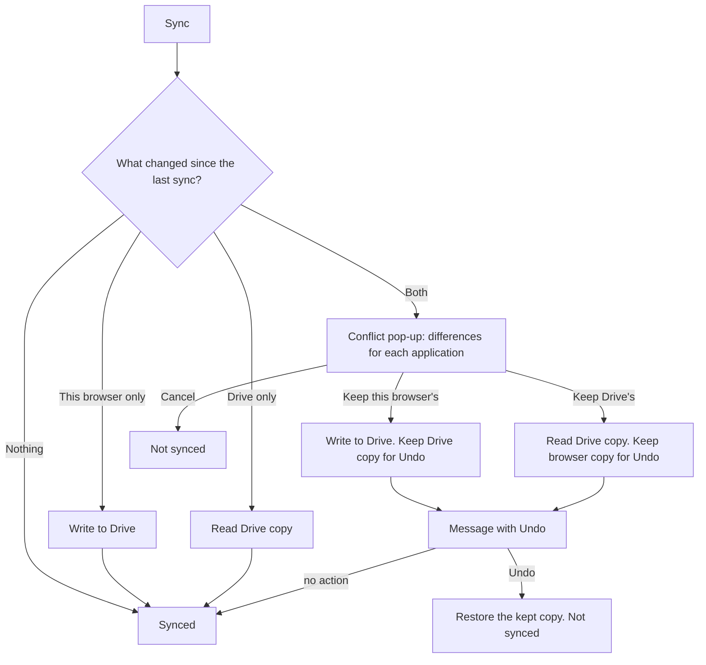
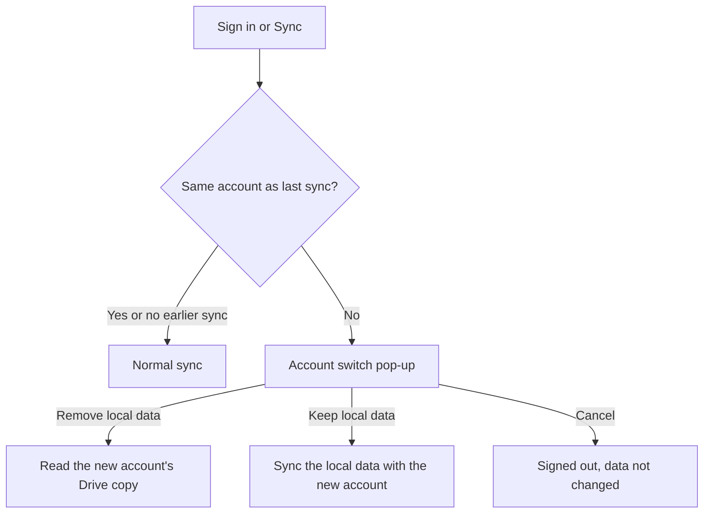
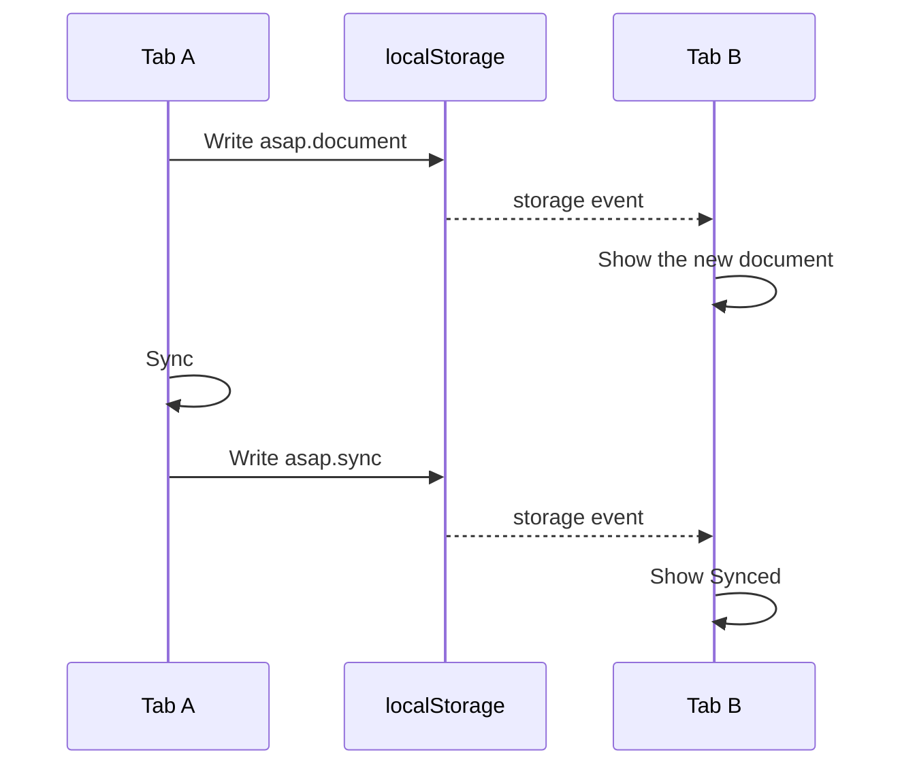

# Flows

## Screens

| Screen | Path | Content |
|---|---|---|
| Home | `/` | Summary (Active, Next round, This week, Gone quiet), Active list, Closed list (collapsed, 20 rows for each "Show more"), calendar (week or month). |
| Application page | `/applications/:id` | Back link to Home, header (company, role, facts, stepper), Edit, Close application… or Reopen, upcoming rounds, past rounds, notes, listing (collapsed). |
| About | `/about` | What ASAP is, where the data is, how to give feedback. |
| Privacy | `/privacy` | The privacy policy. The "Last updated" date comes from git. |
| Not found | other paths | A link to Home. |

### Top bar

Logo (link to Home), today's date, sync status, Sync, Sign out, theme, Download, Upload.

### Footer

About, Privacy, Feedback, Donate.

### Pop-ups

| Pop-up | Opens from | Fields or content |
|---|---|---|
| Application | Add application, Edit | Company, role, location, work mode, applied date, link, extras, listing. Add only: first note. Edit only: Delete. Enter does not save. |
| Round | Add round, a round | Type, day, time, outcome, felt, difficulty, questions, thoughts. |
| Note | Add note, a note | Date, text. |
| Close application | Close application… | The five results, the closed date. |
| Close as Rejected | A round saved as Failed | Close as Rejected, Keep open. |
| Conflict | Sync | Differences for each application. Keep this browser's, Keep Drive's, Cancel. |
| Account switch | Sign in or Sync with another account | Remove local data, Keep local data, Cancel. |
| Sign out | Sign out | Keep the data in this browser, or remove it. |
| Welcome | First visit | What ASAP is, where the data is, Add application, Upload a file. |

### Empty states

| Place | Text |
|---|---|
| Active list | No active applications. |
| Closed list | Hidden when empty. |
| Calendar | The grid shows with no entries. |
| Rounds | No rounds yet. |
| Notes | No notes yet. |

## First visit

The welcome pop-up shows one time for each browser. About shows the same text.

## Add an application

The new application gets the first free color slot and goes to the top of the Active list.

## Plan and record a round

A round without a day is in Upcoming rounds with "Not planned". Upcoming rounds are first on the page, with the nearest first. Past rounds follow, with the newest first.

## Close and reopen

## Before a round, on a phone

## Sync on a new device

## Conflict

Upload and the delete of an application also keep the replaced copy and show a message with Undo.

## Account switch

## Several tabs

All tabs show the same data and the same sync state. A Sync in any tab syncs the same document.
