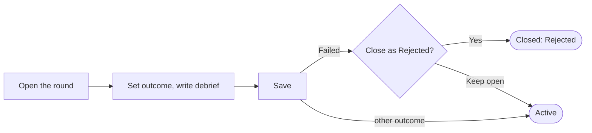
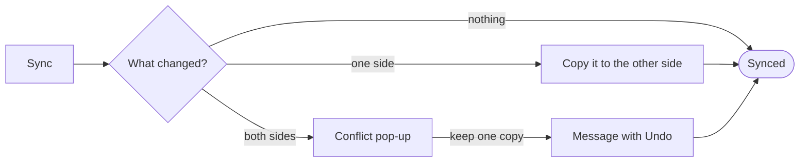

# Flows

## Home

```text
┌───────────────────────────────────────────────────────────────────┐
│ ASAP   Sat 28 Nov        ● Synced  Sync  Sign out  ◐  ↓  ↑        │
├──────────────────────────────┬────────────────────────────────────┤
│ Active 12     [ Upcoming ]   │  Calendar            Week | Month  │
│ + Add application            │                                    │
│ ┃ Contoso Bank               │   Mon  Tue  Wed  Thu  Fri          │
│ ┃ Backend Engineer           │   ■    ■         ■                 │
│ ┃ Technical · tomorrow 14:00 │                                    │
│ ┃ Litware                    │                                    │
│ ┃ Screening on 3 Nov ·       │                                    │
│ ┃   no debrief               │                                    │
│ ┃ Next: Technical 1 Dec      │                                    │
│ …                            │                                    │
│ ▸ Closed 28                  │                                    │
└──────────────────────────────┴────────────────────────────────────┘
  About · Privacy · Feedback · Donate
```

- **Active:** all active applications, the latest activity first. The bar at the left of a card is the application's color.
- **Upcoming toggle on:** only applications with an upcoming round, the soonest round first. Each card shows that round.
- **Closed:** collapsed. It shows 20 rows, and 20 more for each "Show more".
- **Calendar:** rounds of all applications. Week view: hours 08–20. Month view: up to 3 entries for each day, then "+N more".
- On a phone, the calendar goes below the lists.

## Application page

```text
← Home
Contoso Bank                                Edit   Close application…
Backend Engineer · Cluj-Napoca · Hybrid · applied 2 Nov
Applied ── Screening ── [Technical] ── Offer

Upcoming rounds                                          + Add round
  Technical · Tue 1 Dec 14:00 · Pending
Past rounds
  Screening · 10 Nov · Passed · felt 4/5
Notes                                                     + Add note
  25 Nov  Prepare system design.
▸ Listing
```

Upcoming rounds are first, the nearest first. Past rounds follow, the newest first. A closed application shows Reopen instead of Close application….

## Pop-ups

| Pop-up | Content |
|---|---|
| Application | Company, role, location, work mode, applied date, link, extras, listing. When adding: first note. When editing: Delete. Enter does not save. |
| Round | Type, day, time, outcome, debrief. |
| Note | Date, text. |
| Close application | Result, closed date. |
| Close as Rejected | Shows after a round is saved as Failed. Close as Rejected or Keep open. |
| Welcome | First visit only: what ASAP is, where the data is, Add application, Upload. |
| Conflict, Account switch, Sign out | See [Model: Sync](model.md#sync). |

Empty lists show "No active applications.", "No rounds yet." or "No notes yet.". An empty Closed list is hidden.

## Steps

**First visit:** Welcome → Add application, Upload, or Sign in with Google → Home.

**Add an application:** Add application → fill in → Save → application page. The application is at the top of Active.

**Close and reopen:** Close application… → select the result → Close → grey, in Closed. Reopen → active again.

**Before a round, on a phone:** Home → Upcoming on → open the first card → the round is at the top of the page.

**Undo:** after Upload, a conflict choice, or the delete of an application, a message shows with Undo. Undo restores the copy from before.

## After a round



## Sync



**New device:** sign in. If the browser has no data, the app reads the Drive copy. If Drive has no file, the app writes one. If both have data, the Conflict pop-up shows.

**Several tabs:** all tabs show the same data and the same sync state. A Sync in one tab updates all tabs.
