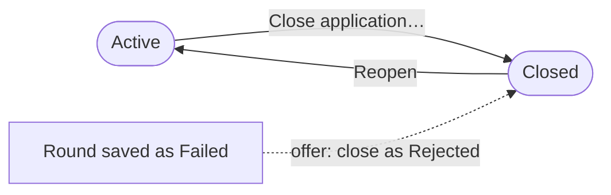
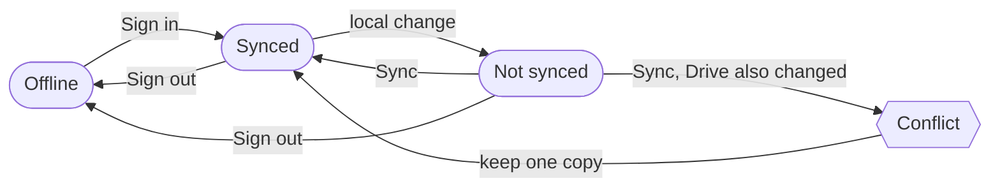

# Model

## Document

All data is one JSON document:

```json
{ "app": "asap", "version": 1, "savedAt": "2026-11-28T10:00:00Z", "applications": [] }
```

Format rules:

1. Add fields. Do not rename or remove fields. A missing field gets a default.
2. Keep fields that the app does not know.
3. Increase `version` only for a breaking change. The app upgrades the old shape when it reads the file.
4. A file with a higher `version` than the app knows opens read-only.

A file from Job Hunt Command Center (it has a `jobs` array) is converted on upload.

## Application

| Field | Content |
|---|---|
| `company` | Required. |
| `role`, `location`, `link` | Text. |
| `workMode` | Remote, Hybrid, On-site, or empty. |
| `appliedDate` | A day, or empty. |
| `listing` | The pasted job listing. Links expire, so the text is kept. |
| `extras` | Label and value pairs that the user adds, for example Salary asked. |
| `result` | Empty while active. Else Hired, Rejected, Withdrew, No reply, or Position closed. |
| `closedDate` | The day the application closed. |
| `color` | A slot in the color sequence. |
| `rounds`, `notes` | Lists. |
| `id`, `createdAt`, `updatedAt` | Not shown. |



- **Active:** `result` is empty. The rounds give the stage. The application has a color.
- **Closed:** `result` and `closedDate` are set. The application is grey.
- **Reopen:** `result` and `closedDate` become empty. The application gets its old color slot back, or the first free slot.

## Round

| Field | Content |
|---|---|
| `type` | Screening, Technical, Offer, or Other. |
| `at` | Day and time. For a take-home task, the due time. Empty when not planned. |
| `outcome` | Pending, Passed, Failed, or Cancelled. The user can change it at any time. |
| `felt`, `difficulty` | 1 to 5. Debrief. |
| `questions`, `thoughts` | Text. Debrief. |

A round is **upcoming** when `at` is in the future, and **past** when `at` is in the past. A round without `at` is **not planned**. The app ignores cancelled rounds for stage, situation and next round.

A round has a debrief when one debrief field has a value.

## Note

A note has a `date` (a day) and `text`. The page shows the newest note first.

## Derived values

The app calculates these values. It does not store them.

| Value | Rule |
|---|---|
| Stage | The highest round type that is not cancelled: Applied → Screening → Technical → Offer. |
| Next round | The first upcoming round. |
| Last activity | The latest of the applied date, round times (also upcoming rounds) and note dates. Sorts the Active list. |
| Closed on | `closedDate`, else last activity. Sorts the Closed list. |
| Situation | The line of facts on a card. See below. |

### Situation

The first rule that matches gives the card text.

| # | When | Card shows |
|---|---|---|
| 1 | Next round in 48 hours or less | Technical tomorrow at 14:00 |
| 2 | A past round has no debrief | Screening on 3 Nov · no debrief |
| 3 | Last round pending for 14 days or more | Technical 16 days ago · no result |
| 4 | Last round passed, nothing upcoming | Passed screening on 3 Nov |
| 5 | Last round failed, still active | Failed technical on 3 Nov |
| 6 | No rounds, applied 14 days ago or more | Applied 20 days ago · no reply |
| 7 | Next round in more than 48 hours | Screening on 1 Dec at 10:00 |
| 8 | Other | Applied 3 days ago |

When the line is not about the next round and a next round exists, the card shows the next round on a second line.

## Colors

- Slot *n* has the hue *n* × 137.508° and one of three lightness steps. The light theme uses darker steps.
- The sequence does not start with red.
- A new application gets the first slot that no active application uses.
- Closed applications are grey, so their slots are free.

## Local storage

| Key | Content |
|---|---|
| `asap.document` | The document. Written after each change. |
| `asap.document.broken` | A stored document that the app cannot read. Kept, not deleted. |
| `asap.previous` | The copy before the last replace. Used for Undo. |
| `asap.sync` | The sync state. |
| `asap.prefs` | Calendar view, Upcoming toggle, Closed list open, listing open, theme. |

All tabs share these keys. When one tab writes a key, the other tabs read the new value.

## Sync



The sync state holds:

- the Google account and its Drive permission ID,
- the ID of the Drive file `ASAP/asap-data.json`,
- the Drive file version at the last sync,
- the hash of the local document at the last sync.

The local copy has changes when its hash differs. Drive has changes when its version differs. When only one side changed, Sync copies it to the other side.

- **Conflict:** a pop-up lists each application that is different, with what changed on each side (added, removed, details, rounds, notes, result). The user keeps one copy. The other copy goes to `asap.previous`, and a message with Undo shows.
- **Account switch:** if the account is not the one from the last sync, a pop-up asks to remove or keep the local data before the sync.
- **Leave-page warning:** only in Not synced.
- **Limit:** Drive has no conditional write. If two devices sync at the same moment, the last write wins.
