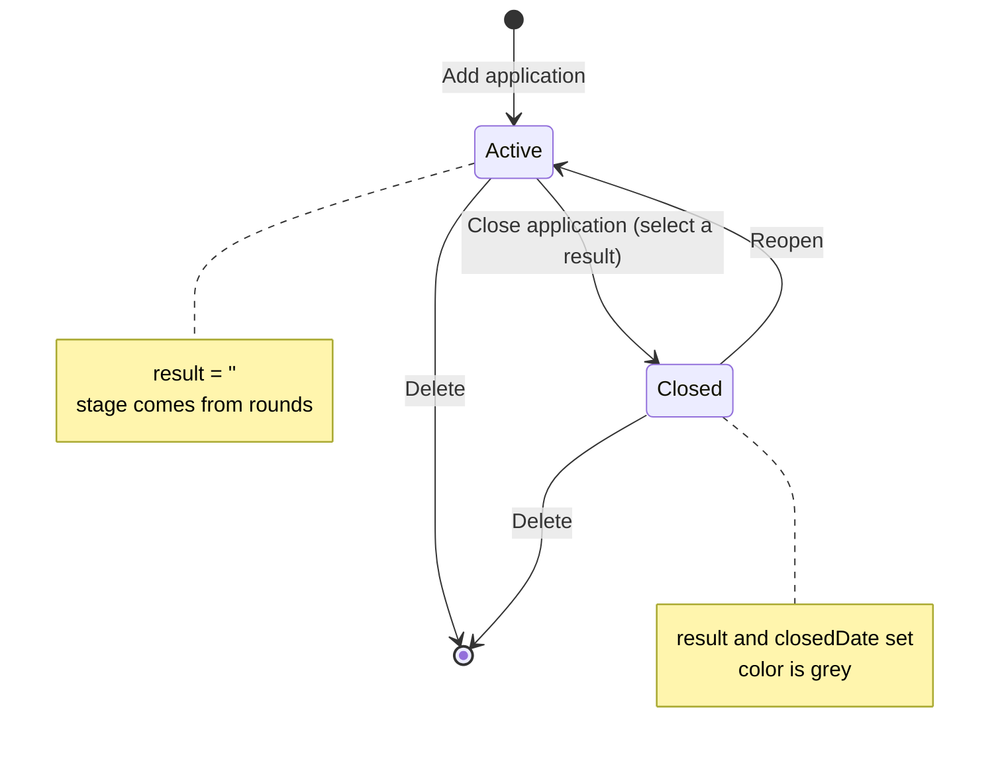
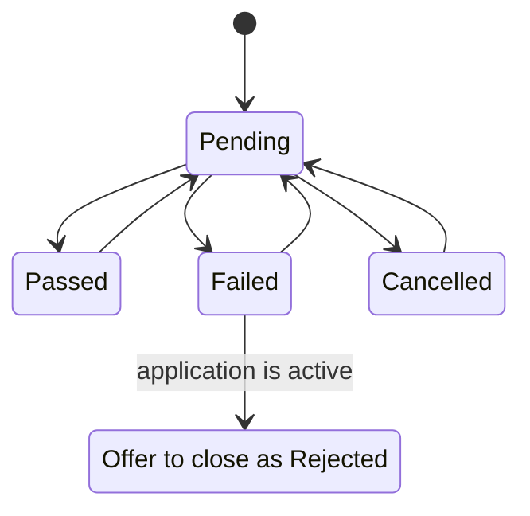
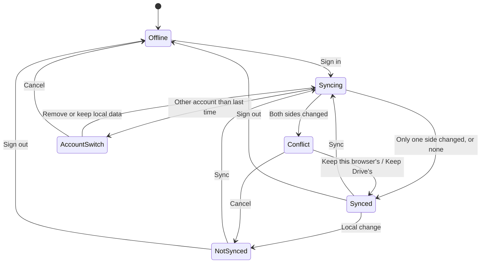

# Model

## Document

All data is one JSON document.

| Field | Type | Description |
|---|---|---|
| `app` | `"asap"` | Identifies the file. |
| `version` | number | The format version. Now `1`. |
| `savedAt` | ISO instant | The time of the last write. |
| `applications` | Application[] | All applications, active and closed. |

### Format rules

1. Add fields. Do not rename or remove fields. A new field is optional and gets a default when it is missing. `version` does not change.
2. Keep fields that the app does not know. Write them again without change.
3. Increase `version` only for a breaking change. A function upgrades the old shape one time, when the app reads the file.
4. A file with a `version` higher than the app knows opens read-only.

A file from Job Hunt Command Center (it has a `jobs` array) is converted when the user uploads it. The conversion maps the statuses to rounds and results, and adds an offer round for an offer status.

## Application

| Field | Type | Shown on | Notes |
|---|---|---|---|
| `id` | UUID | — | |
| `company` | text | card, page, calendar | Required. |
| `role` | text | card, page | |
| `location` | text | page | |
| `workMode` | `''`, `remote`, `hybrid`, `onsite` | page | The page shows one value when location and work mode are the same word. |
| `appliedDate` | day | card, page | `YYYY-MM-DD`, or empty. |
| `link` | URL | page | |
| `listing` | text | page | The pasted job listing. Collapsed by default. Links expire, so the text is kept. |
| `extras` | {label, value}[] | page | Fields that the user adds. Suggested labels: Salary asked, Salary offered. |
| `result` | Result | card, page, Closed list | Empty while active. |
| `closedDate` | day | page, Closed list | Set with `result`. Empty while active. |
| `color` | number | — | A slot in the color sequence. See [Colors](#colors). |
| `createdAt` | ISO instant | — | |
| `updatedAt` | ISO instant | — | |
| `rounds` | Round[] | page, calendar | |
| `notes` | Note[] | page | |

### Result

| Value | Label | Use |
|---|---|---|
| `''` | Ongoing | The application is active. |
| `hired` | Hired | The user accepted an offer. |
| `rejected` | Rejected | The company stopped the process. |
| `withdrew` | Withdrew | The user stopped the process, or declined an offer. |
| `no-reply` | No reply | The company did not reply. |
| `position-closed` | Position closed | The role is filled, the listing is removed, or hiring stops. |

### Lifecycle

When a round becomes Failed and the application is active, the app offers to close the application as Rejected. The user can refuse.

When an application reopens, `result` and `closedDate` become empty. The application keeps its color slot. If an active application uses that slot, the application gets the first free slot.

## Round

| Field | Type | Shown on | Notes |
|---|---|---|---|
| `id` | UUID | — | |
| `type` | `screening`, `technical`, `offer`, `other` | card, page, calendar | |
| `at` | ISO instant or null | card, page, calendar | The start time. For a take-home task, the due time. Null when not planned. The form has one field for the day and one for the time. |
| `outcome` | `pending`, `passed`, `failed`, `cancelled` | page | |
| `felt` | 1–5 or null | page | Debrief: how the round felt. |
| `difficulty` | 1–5 or null | page | Debrief: how difficult the round was. |
| `questions` | text | page | Debrief. |
| `thoughts` | text | page | Debrief. |

A round has a debrief when one of `felt`, `difficulty`, `questions` or `thoughts` has a value.

### Outcome

The user can change the outcome to any value at any time. The diagram shows the usual path.

A round is upcoming when `at` is in the future. A round is past when `at` is in the past. A round without `at` is neither. The app ignores cancelled rounds for stage, situation and next round.

## Note

| Field | Type | Shown on |
|---|---|---|
| `id` | UUID | — |
| `date` | day | page |
| `text` | text | page |

The page shows notes with the newest first.

## Derived values

The app calculates these values. It does not store them.

| Value | Rule | Shown on |
|---|---|---|
| Stage | The highest round type that is not cancelled: Applied, Screening, Technical, Offer. Other rounds do not count. | card, page (stepper) |
| Stage label | The result label when closed. Else the stage. | card, Closed list |
| Last activity | The latest of `appliedDate`, round `at` (also planned rounds), and note `date`. Edits do not count. | Order of the Active list (newest first) |
| Closed on | `closedDate`, else last activity. | Order of the Closed list (newest first) |
| Next round | The first upcoming round that is not cancelled. | card, page, Home summary |
| Situation | See [Situation](#situation). | card |
| This week | Applications sent and rounds held from Monday to Sunday of this week. | Home summary |
| Gone quiet | Active applications with the situation No reply or Result overdue. | Home summary |

### Situation

Each active application has one situation. The app tests the rules in this order. The first rule that matches is the situation.

| Order | Situation | Rule | Card text (example) |
|---|---|---|---|
| 1 | Round soon | The next round starts in 48 hours or less. | Technical tomorrow at 14:00 |
| 2 | Needs debrief | A past round has no debrief. | Screening on 3 Nov · no debrief |
| 3 | Result overdue | No next round. The last round is pending and is 14 days old or more. | Technical 16 days ago · no result |
| 4 | Passed, nothing next | No next round. The last round is passed. | Passed screening on 3 Nov |
| 5 | Failed, still open | No next round. The last round is failed. | Failed technical on 3 Nov |
| 6 | No reply | No dated rounds. Applied 14 days ago or more. | Applied 20 days ago · no reply |
| 7 | Round later | The next round starts in more than 48 hours. | Screening on 1 Dec at 10:00 |
| 8 | Waiting | No other rule matches. | Applied 3 days ago |

When the situation is not about the next round and a next round exists, the card also shows the next round on a second line.

## Colors

- Colors come from one fixed sequence. Slot *n* has the hue *n* × 137.508° and one of three lightness steps. The lightness steps are CSS variables, so the light theme uses darker colors.
- The sequence starts at a hue that is not red.
- A new application gets the first slot that no active application uses.
- A closed application shows grey (`--muted`). Its slot is free for new applications.
- The color of an application is the same on its card, its page and in the calendar.

## Local storage

| Key | Content |
|---|---|
| `asap.document` | The document. The app writes it after each change. |
| `asap.document.broken` | A copy of a stored document that the app cannot read. The app does not delete it. |
| `asap.previous` | The copy before the last replace (Keep after a conflict, Upload, or the delete of an application). Used for Undo. |
| `asap.sync` | The sync state. Shared by all tabs. |
| `asap.prefs` | View preferences: calendar view, Closed list open, listing open, theme. |

When one tab writes `asap.document` or `asap.sync`, the other tabs read the new value.

## Sync

### Sync state

| Field | Description |
|---|---|
| `account` | The email of the Google account. |
| `owner` | The Drive permission ID of the account. Used to detect an account switch. |
| `fileId` | The Drive file `ASAP/asap-data.json`. |
| `version` | The Drive file version at the last sync. |
| `syncedHash` | The hash of the local document at the last sync. |

The local copy has changes when its hash is not `syncedHash`. Drive has changes when its file version is not `version`.

### States

| State | Status text |
|---|---|
| Offline | Offline mode |
| Synced | Synced |
| Not synced | Not synced |
| Syncing | Syncing… |
| Conflict | Pop-up: Changed in two places |
| Account switch | Pop-up: Other Google account |

- All tabs show the same state, because the sync state is shared.
- In Syncing, when only the local copy changed, the app writes it to Drive. When only Drive changed, the app reads the Drive copy.
- The browser shows the leave-page warning only in Not synced.
- Drive has no conditional write. If two devices sync at the same time, the last write wins.

### Conflict

The pop-up lists each application that is different in the two copies:

| Column | Content |
|---|---|
| Application | Company and role. |
| This browser | Added, Removed, or the changed parts (details, rounds, notes, result) with the date of the last change. |
| Drive | The same for the Drive copy. |

The user selects one copy. The other copy goes to `asap.previous`. A message with Undo shows after the replace.
